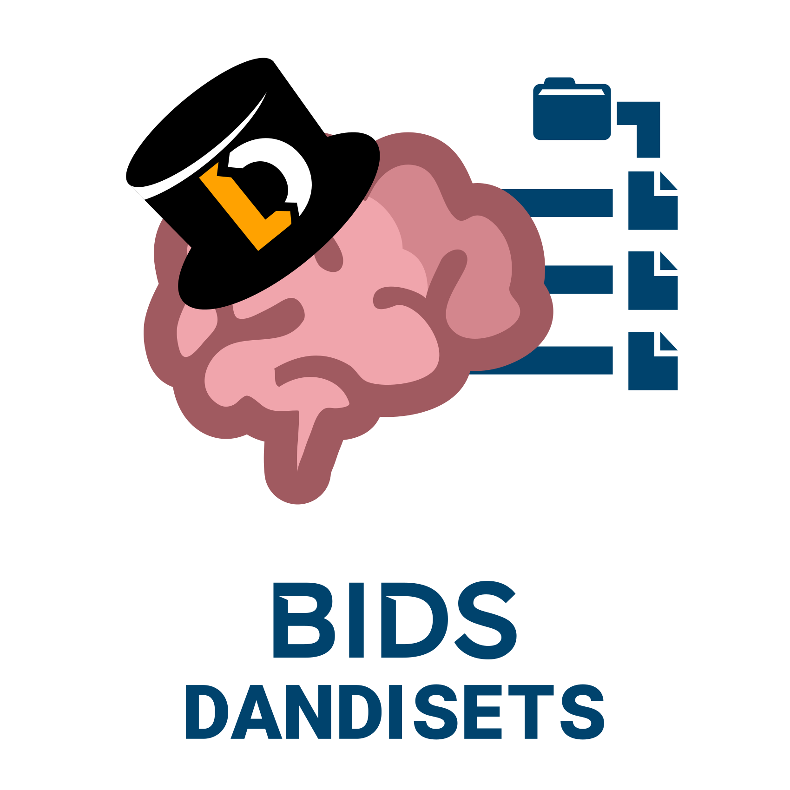

<p align="center">
  <picture>
    <source media="(prefers-color-scheme: dark)" srcset=".github/assets/bids-dandisets-logo-square.svg">
    
  </picture>
</p>

<p align="center">
  The super-dataset of all <a href="https://github.com/bids-dandisets">BIDS-Dandisets</a>:
  Dandisets from the <a href="https://dandiarchive.org">DANDI Archive</a>
  reorganized into <a href="https://bids.neuroimaging.io">BIDS</a>.
</p>

## About

Each Dandiset is a git submodule pointing to `https://github.com/bids-dandisets/<dandiset-id>`, a DataLad dataset
holding the BIDS version of that Dandiset, generated by [nwb2bids](https://github.com/con/nwb2bids).
Submodules are grouped by the first three digits of their ID, so Dandiset `000003` lives at `000/000003`
and Dandiset `001234` at `001/001234`.
The [Update Super-dataset](.github/workflows/update-super-dataset.yml) workflow refreshes the submodules nightly.

To get a single Dandiset without fetching all of them:

```bash
git clone https://github.com/dandi/bids-dandisets
cd bids-dandisets
git submodule update --init 000/000003
```
